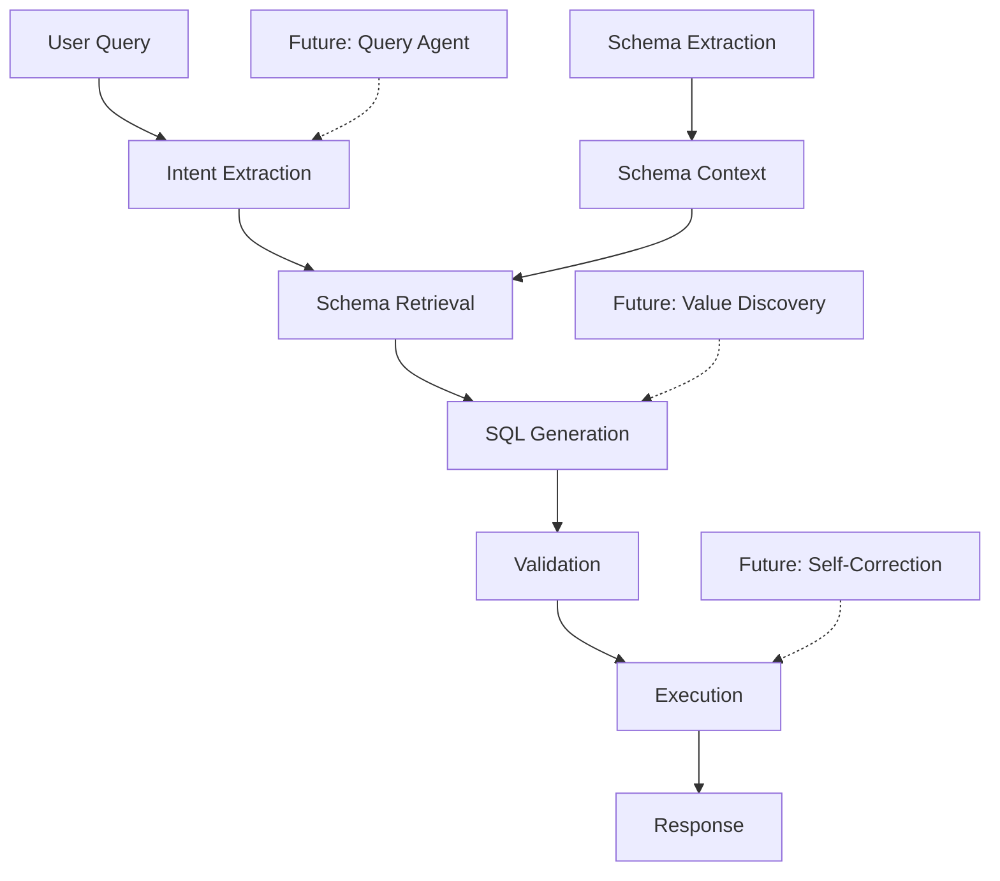

# SENS Documentation

Welcome to the SENS (Semantic Natural SQL) documentation. This guide will help you navigate the project documentation.

## 📚 Documentation Structure

### Getting Started
- [Main README](../README.md) - Project overview and quick start
- [CLAUDE.md](../CLAUDE.md) - Instructions for AI-assisted development
- [Deployment Guide](../DEPLOYMENT.md) - Comprehensive deployment instructions
- [Test Coverage](../TEST_COVERAGE.md) - Current test coverage status

### 📐 Current Architecture

Documentation for the existing SENS system:

#### Core Systems
- [Data Loading Guide](./data_loading.md) - **Complete guide to loading financial data**
- [Schema Context Management](./architecture/current/schema_context.md) - How SENS understands database schemas
- [Schema Extraction](./architecture/current/schema_extraction_architecture.md) - Extracting metadata from databases
- [Data Source Architecture](./architecture/current/data_source_architecture.md) - Multi-datasource support (PostgreSQL, DuckDB, etc.)
- [CLI Commands](./architecture/current/cli_commands.md) - Command-line interface specification

#### Features
- [UI/UX Design](./features/ui_ux_design.md) - Frontend design and implementation
- [Multi-File Support](./features/multi_file_product_architecture.md) - Handling multiple related CSV/Excel files
- [Schema Visualization](./features/schema_visualization_implementation_2025.md) - Interactive schema explorer

### 🚀 Future Architecture (Agentic System)

Documentation for the planned intelligent query system:

- [Agentic Query Architecture](./architecture/future/agentic_query_architecture.md) - Core design for intelligent query understanding
- [Implementation Plan](./architecture/future/agentic_implementation_plan.md) - Step-by-step implementation guide
- [Agent Architecture Design](./architecture/future/agent_architecture_design.md) - Detailed agent patterns and behaviors
- [Proactive Insights](./architecture/future/proactive_architecture.md) - System for generating insights before users ask

### 🗺️ Roadmap & Planning

- [ROADMAP.md](../ROADMAP.md) - Long-term vision and implementation phases
- [Next Steps](./NEXT_STEPS.md) - Immediate priorities and action items

## 🔍 Quick Links by Topic

### For Users
- [Getting Started](../README.md#quick-start)
- [CLI Usage](./cli_commands.md)
- [Deployment Guide](../DEPLOYMENT.md)

### For Developers
- [Architecture Overview](./schema_context.md)
- [Test Coverage](../TEST_COVERAGE.md)
- [Contributing Guidelines](../README.md#contributing)

### For AI Development
- [Claude Instructions](../CLAUDE.md)
- [Agentic Architecture](./agentic_query_architecture.md)

## 📊 System Overview

## 🏗️ Architecture Principles

1. **Modular Design** - Each component has a single responsibility
2. **Safety First** - Multiple validation layers before execution
3. **Performance** - Optimized retrieval with caching
4. **Extensibility** - Plugin architecture for new data sources
5. **Intelligence** - Moving towards self-learning system

## 📈 Project Status

- **Current Phase**: Foundation Strengthening & Early Agentic Features
- **Test Coverage**: 87.3%
- **Supported Databases**: PostgreSQL, DuckDB, MySQL (beta)
- **API Stability**: Stable v1.0

## 🤝 Contributing

See the [main README](../README.md#contributing) for contribution guidelines.

For documentation updates:
1. Keep docs close to code
2. Update when features change
3. Include examples
4. Follow existing style

## 📝 Documentation TODO

- [ ] Add API reference documentation
- [ ] Create user tutorials
- [ ] Add architecture decision records (ADRs)
- [ ] Document deployment best practices
- [ ] Add troubleshooting guide

---

Last updated: January 2025