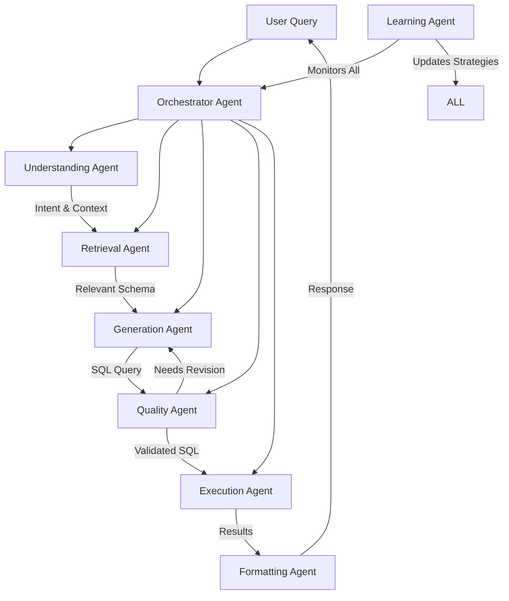

# Agent Architecture Design for SENS

## Overview

This document outlines a comprehensive agent-based architecture for SENS that could significantly improve the system's intelligence, adaptability, and user experience. This design is currently in the backlog and will be refined based on real-world usage patterns and identified pain points.

## Current Architecture Analysis

### Pain Points in Current System

1. **Rigid Pipeline**: Linear execution with no ability to self-correct or try alternatives
2. **Limited Context**: Each query is processed independently without learning
3. **Fixed Strategies**: Retrieval and generation use predetermined rules
4. **No Learning**: System doesn't improve from successes or failures
5. **Poor Error Recovery**: When queries fail, users get errors instead of alternatives

### Areas for Improvement

```
Current Flow:
User Query → Intent → Retrieval → Generation → Validation → Execution → Response

Issues:
- No feedback loops
- No alternative strategies
- No context awareness
- No proactive assistance
```

## Proposed Agent Architecture

### System Overview



## Detailed Agent Specifications

### 1. Orchestrator Agent

**Purpose**: Master coordinator that manages the entire query processing pipeline

```python
class OrchestratorAgent:
    """
    Responsibilities:
    - Coordinate all other agents
    - Maintain conversation context
    - Handle retries and fallbacks
    - Monitor performance
    """
    
    async def process_query(self, query: str, session_id: str):
        # Build context from history
        context = await self.build_context(query, session_id)
        
        # Create adaptive execution plan
        plan = await self.create_plan(query, context)
        
        # Execute with monitoring
        result = await self.execute_plan(plan)
        
        # Learn from execution
        await self.learning_agent.record(plan, result)
        
        return result
```

### 2. Understanding Agent

**Purpose**: Deep semantic understanding of user intent

```python
class UnderstandingAgent:
    """
    Capabilities:
    - Intent classification beyond simple categories
    - Ambiguity detection and resolution
    - Context-aware interpretation
    - Domain knowledge application
    """
    
    async def analyze(self, query: str, context: dict):
        # Multi-dimensional analysis
        understanding = {
            'primary_intent': await self.extract_intent(query),
            'implicit_needs': await self.infer_unstated_requirements(query),
            'complexity': await self.assess_complexity(query),
            'ambiguities': await self.detect_ambiguities(query),
            'domain_context': await self.apply_domain_knowledge(query)
        }
        
        return understanding
```

### 3. Retrieval Agent

**Purpose**: Intelligent schema retrieval with adaptive strategies

```python
class RetrievalAgent:
    """
    Strategies:
    - Semantic search for conceptual matches
    - Token search for exact matches
    - Graph traversal for relationships
    - Hybrid approaches based on query type
    """
    
    async def retrieve_schema(self, understanding: dict, full_schema: dict):
        # Decide strategy based on understanding
        strategy = await self.select_strategy(understanding)
        
        # Execute retrieval
        results = await strategy.retrieve(understanding, full_schema)
        
        # Optimize results
        optimized = await self.optimize_schema_selection(results, understanding)
        
        return optimized
```

### 4. Generation Agent

**Purpose**: Sophisticated SQL generation with multiple techniques

```python
class GenerationAgent:
    """
    Techniques:
    - Template-based for common patterns
    - Example-based for similar queries
    - Step-by-step for complex logic
    - Multi-strategy with selection
    """
    
    async def generate(self, understanding: dict, schema: dict):
        # Try multiple generation strategies
        candidates = await self.generate_candidates(understanding, schema)
        
        # Select best candidate
        best_sql = await self.select_best_sql(candidates, understanding)
        
        # Optimize if needed
        if self.needs_optimization(best_sql):
            best_sql = await self.optimize(best_sql)
        
        return best_sql
```

### 5. Quality Agent

**Purpose**: Comprehensive validation and improvement

```python
class QualityAgent:
    """
    Validations:
    - Syntax correctness
    - Semantic alignment with intent
    - Performance characteristics
    - Safety and security
    - Result format expectations
    """
    
    async def validate(self, sql: str, understanding: dict):
        validations = await asyncio.gather(
            self.validate_syntax(sql),
            self.validate_semantics(sql, understanding),
            self.validate_performance(sql),
            self.validate_safety(sql)
        )
        
        if all(v.passed for v in validations):
            return ValidationResult(passed=True)
        
        # Generate fixes
        fixes = await self.generate_fixes(sql, validations)
        return ValidationResult(passed=False, fixes=fixes)
```

### 6. Learning Agent

**Purpose**: Continuous improvement through pattern recognition

```python
class LearningAgent:
    """
    Learning Dimensions:
    - Success patterns
    - Failure patterns
    - User preferences
    - Performance optimization
    - New use cases
    """
    
    async def learn_from_execution(self, execution: dict):
        # Extract patterns
        patterns = await self.extract_patterns(execution)
        
        # Update strategy weights
        await self.update_strategies(patterns)
        
        # Identify improvements
        improvements = await self.identify_improvements(patterns)
        
        # Store for future use
        await self.persist_learning(patterns, improvements)
```

## Agent Communication Protocol

### Message Format

```python
@dataclass
class AgentMessage:
    sender: str
    receiver: str
    message_type: MessageType
    payload: dict
    context: dict
    timestamp: datetime
    correlation_id: str
```

### Communication Patterns

1. **Request-Response**: Direct agent-to-agent communication
2. **Broadcast**: Announcements to all agents
3. **Event-Driven**: Asynchronous notifications
4. **Blackboard**: Shared workspace for collaboration

## Implementation Strategies

### Phase 1: Wrapper Approach

Wrap existing components with agent interfaces:

```python
class AgentWrapper:
    def __init__(self, legacy_component):
        self.legacy = legacy_component
        self.agent_capabilities = []
    
    async def process(self, input_data):
        # Add agent intelligence
        enhanced_input = await self.pre_process(input_data)
        
        # Use legacy component
        result = await self.legacy.process(enhanced_input)
        
        # Enhance output
        enhanced_result = await self.post_process(result)
        
        return enhanced_result
```

### Phase 2: Gradual Migration

1. Start with Generation Agent (highest impact)
2. Add Quality Agent for validation
3. Implement Understanding Agent
4. Integrate Learning Agent
5. Full orchestration

### Phase 3: Native Agent Architecture

Complete rewrite with agents as first-class citizens.

## Expected Benefits

### Quantitative Improvements

- **50-70% reduction** in query failures
- **30-40% improvement** in response time for complex queries
- **80% reduction** in similar error patterns
- **25% reduction** in support requests

### Qualitative Improvements

- **Self-healing**: Automatic error recovery
- **Context awareness**: Better understanding of user needs
- **Proactive assistance**: Suggest insights before asked
- **Continuous learning**: System improves over time
- **Better UX**: More natural interactions

## Technical Considerations

### Infrastructure Requirements

```yaml
Agent Infrastructure:
  Message Queue: 
    - RabbitMQ or Redis Streams
    - For inter-agent communication
  
  State Management:
    - Redis for short-term state
    - PostgreSQL for long-term patterns
  
  Monitoring:
    - OpenTelemetry for tracing
    - Prometheus for metrics
  
  Compute:
    - Async Python for concurrency
    - Optional GPU for embeddings
```

### LLM Integration

```python
class AgentLLMInterface:
    """
    Standardized LLM interface for all agents
    """
    def __init__(self, model_config):
        self.primary_model = model_config.primary
        self.fallback_model = model_config.fallback
        self.cache = LLMCache()
    
    async def query(self, prompt: str, context: dict):
        # Check cache
        cached = await self.cache.get(prompt, context)
        if cached:
            return cached
        
        # Try primary model
        try:
            result = await self.primary_model.query(prompt)
        except:
            # Fallback
            result = await self.fallback_model.query(prompt)
        
        # Cache result
        await self.cache.set(prompt, context, result)
        
        return result
```

## Risk Mitigation

### Potential Risks

1. **Complexity**: More moving parts
2. **Latency**: Inter-agent communication overhead
3. **Cost**: More LLM calls
4. **Debugging**: Harder to trace issues

### Mitigation Strategies

1. **Gradual rollout** with feature flags
2. **Comprehensive monitoring** and tracing
3. **Fallback mechanisms** to legacy system
4. **Cost controls** with budgets and caching
5. **Debug mode** with detailed logging

## Future Enhancements

### Advanced Capabilities

1. **Multi-modal Understanding**: Process images, documents
2. **Predictive Queries**: Anticipate user needs
3. **Collaborative Agents**: Multiple agents working together
4. **Domain Specialization**: Industry-specific agents
5. **AutoML Integration**: Automatic model improvement

### Integration Possibilities

```python
class ExternalIntegrationAgent:
    """
    Connect with external systems
    """
    integrations = {
        'slack': SlackNotificationAgent(),
        'jira': JiraTicketAgent(),
        'tableau': TableauVisualizationAgent(),
        'dbt': DBTTransformationAgent()
    }
```

## Metrics and Monitoring

### Key Performance Indicators

```python
agent_metrics = {
    'query_success_rate': 0.85,  # Target: 0.95
    'self_healing_rate': 0.60,   # Target: 0.80
    'context_relevance': 0.75,   # Target: 0.90
    'learning_efficiency': 0.70,  # Target: 0.85
    'user_satisfaction': 0.80     # Target: 0.95
}
```

### Monitoring Dashboard

```python
class AgentMonitoringDashboard:
    """
    Real-time agent performance monitoring
    """
    panels = [
        'Agent Communication Flow',
        'Success/Failure Rates by Agent',
        'Learning Progress Metrics',
        'Resource Utilization',
        'User Experience Metrics'
    ]
```

## Conclusion

This agent architecture represents a significant evolution for SENS, moving from a rigid pipeline to an intelligent, adaptive system. While the implementation effort is substantial, the benefits in terms of user experience, system reliability, and continuous improvement make it a worthwhile long-term investment.

The design will be refined based on:
1. Real-world usage patterns
2. Identified pain points in current system
3. Resource availability
4. Technical feasibility studies
5. User feedback and requirements

## Next Steps

1. **Proof of Concept**: Build simple Generation Agent
2. **Measure Impact**: Compare with current system
3. **Refine Design**: Based on POC learnings
4. **Gradual Implementation**: Start with highest-impact agents
5. **Continuous Evaluation**: Monitor and adjust

---

*Last Updated: May 2024*
*Status: Design Phase - Backlog*
*Version: 1.0*