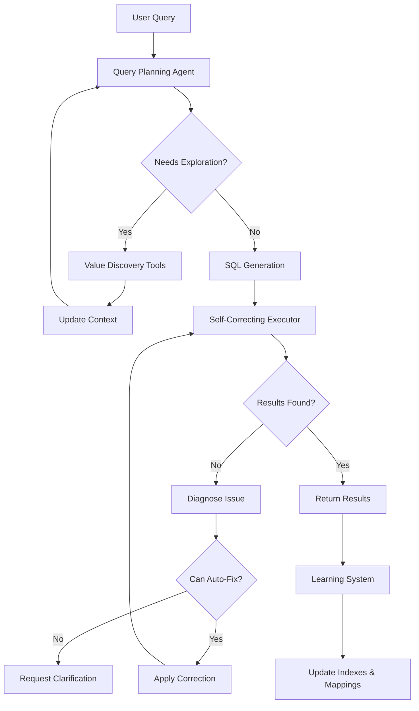

# Agentic Query Architecture for SENS

## Executive Summary

The current SENS system has a fundamental limitation: it assumes user input directly maps to database values. This document outlines an evolution to an agentic architecture that can intelligently explore, reason, and learn to bridge the gap between user intent and database reality.

## Current Limitations

1. **Value Mismatch Problem**
   - User says "tech companies" but database has "Technology"
   - User says "Apple" but database might have "AAPL" or "Apple Inc."
   - User says "last month" but needs specific date ranges
   - User says "large companies" but needs to infer market cap thresholds

2. **Static Query Generation**
   - One-shot SQL generation without exploration
   - No ability to refine based on empty results
   - No learning from past successes/failures

3. **Limited Context Understanding**
   - No domain knowledge (e.g., FAANG companies, sector classifications)
   - No temporal reasoning for relative dates
   - No value distribution awareness

## Proposed Agentic Architecture

### Core Components

#### 1. Query Planning Agent
Decomposes user queries into sub-tasks using ReAct-style reasoning.

```python
class QueryPlanningAgent:
    """
    Analyzes user intent and creates an execution plan.
    
    Example reasoning chain:
    User: "Show me tech giants' performance last quarter"
    
    Thought 1: Need to identify what "tech giants" means
    Action 1: SearchKnownEntities("tech giants")
    Observation 1: Common aliases for large tech companies include FAANG, Big Tech
    
    Thought 2: Need to find these companies in our database
    Action 2: SearchDatabaseValues(table="securities", column="sector", pattern="tech*")
    Observation 2: Found sector="Technology" with companies AAPL, GOOGL, MSFT, META, NVDA
    
    Thought 3: Need to filter for "giants" - likely means large market cap
    Action 3: GetValueDistribution(table="securities", column="market_cap", filter="sector='Technology'")
    Observation 3: Tech companies range from $10B to $3.5T market cap
    
    Thought 4: Define "giants" as top quartile by market cap
    Action 4: BuildFilter(market_cap > $500B)
    
    Thought 5: Need to resolve "last quarter" to date range
    Action 5: ResolveTemporal("last quarter", reference_date=today)
    Observation 5: Q4 2024 = 2024-10-01 to 2024-12-31
    
    Final Plan: Generate SQL for tech companies with market_cap > $500B, 
                price data between 2024-10-01 and 2024-12-31
    """
```

#### 2. Value Discovery Tools

```python
class ValueDiscoveryTools:
    """Tools the agent can use to explore database values."""
    
    async def search_distinct_values(
        self, 
        table: str, 
        column: str, 
        pattern: str = None,
        limit: int = 100
    ) -> List[str]:
        """Search for actual values in a column."""
        
    async def find_similar_values(
        self,
        target: str,
        table: str,
        column: str,
        similarity_threshold: float = 0.7
    ) -> List[Tuple[str, float]]:
        """Find values similar to target using embedding similarity."""
        
    async def get_value_statistics(
        self,
        table: str,
        column: str,
        filter_condition: str = None
    ) -> Dict[str, Any]:
        """Get min, max, distribution, common values for a column."""
        
    async def search_cross_column(
        self,
        search_term: str,
        tables: List[str] = None
    ) -> List[Dict[str, Any]]:
        """Search for a term across multiple columns and tables."""
```

#### 3. Value Mapping Index

```python
class ValueMappingIndex:
    """
    Maintains mappings between user terms and database values.
    Learns from successful queries.
    """
    
    def __init__(self):
        self.mappings = {
            # Static mappings
            "tech": ["Technology", "Information Technology"],
            "finance": ["Financial Services", "Financials"],
            "healthcare": ["Healthcare", "Health Care"],
            
            # Company aliases
            "Apple": ["AAPL", "Apple Inc.", "Apple Computer"],
            "Google": ["GOOGL", "GOOG", "Alphabet Inc.", "Alphabet"],
            
            # Learned mappings (from user queries)
            "big tech": {
                "type": "entity_group",
                "members": ["AAPL", "GOOGL", "MSFT", "META", "AMZN"],
                "confidence": 0.95,
                "learned_from": ["query_id_123", "query_id_456"]
            }
        }
        
    async def learn_from_query(
        self,
        user_term: str,
        resolved_value: str,
        context: Dict[str, Any],
        success: bool
    ):
        """Learn new mappings from successful queries."""
```

#### 4. Self-Correcting Executor

```python
class SelfCorrectingExecutor:
    """
    Executes queries and attempts to fix them if they return no results.
    """
    
    async def execute_with_retry(
        self,
        sql: str,
        context: QueryContext,
        max_attempts: int = 3
    ) -> QueryResult:
        """
        Execute SQL and attempt fixes if no results.
        
        Correction strategies:
        1. Broaden date ranges
        2. Relax filter conditions  
        3. Check for typos in values
        4. Try alternative value mappings
        5. Suggest clarifications to user
        """
```

#### 5. Learning System

```python
class QueryLearningSystem:
    """
    Learns from query patterns, successes, and failures.
    """
    
    def __init__(self):
        self.query_history = QueryHistoryStore()
        self.pattern_matcher = PatternMatcher()
        self.feedback_processor = FeedbackProcessor()
        
    async def learn_from_execution(
        self,
        query: UserQuery,
        execution_trace: ExecutionTrace,
        result: QueryResult
    ):
        """
        Learn from each query execution:
        - Successful value mappings
        - Effective query patterns
        - Common user terminology
        - Temporal patterns
        """
        
    async def suggest_query_improvements(
        self,
        query: str,
        context: QueryContext
    ) -> List[QuerySuggestion]:
        """
        Based on similar past queries, suggest improvements.
        """
```

### Execution Flow



### Example: Intelligent Query Resolution

**User Query**: "Show me large tech companies' performance in Q3"

**Agent Reasoning Process**:

```yaml
Step 1: Intent Analysis
  Thought: Need to understand "large tech companies"
  Action: SearchDatabaseValues(table="securities", column="sector")
  Result: Found sectors including "Technology", "Communication Services"
  
Step 2: Define "Large"
  Thought: "Large" is relative, need market cap distribution
  Action: GetValueStatistics(table="securities", column="market_cap", filter="sector='Technology'")
  Result: Market caps range from $10B to $3.5T, median $150B
  Decision: Define "large" as market_cap > $500B
  
Step 3: Resolve Temporal
  Thought: "Q3" needs year context
  Action: InferTemporalContext("Q3")
  Result: Likely means Q3 2024 (most recent complete quarter)
  
Step 4: Initial Query
  SQL: SELECT s.symbol, s.company_name, dp.trade_date, dp.close_price
       FROM securities s
       JOIN daily_prices_2024_07 dp ON s.symbol = dp.symbol
       WHERE s.sector = 'Technology' 
       AND s.market_cap > 500000000000
       AND dp.trade_date BETWEEN '2024-07-01' AND '2024-09-30'
       
Step 5: Execution
  Result: 0 rows
  
Step 6: Diagnosis
  Thought: Query returned no results, need to investigate
  Action: CheckTableData("daily_prices_2024_07")
  Result: Table is empty
  
Step 7: Correction
  Thought: Need to find which partition has Q3 2024 data
  Action: SearchDataAvailability(date_range="2024-07-01 to 2024-09-30")
  Result: Data available in daily_prices table, not partitions
  
Step 8: Retry
  SQL: SELECT s.symbol, s.company_name, dp.trade_date, dp.close_price
       FROM securities s
       JOIN daily_prices dp ON s.symbol = dp.symbol
       WHERE s.sector = 'Technology' 
       AND s.market_cap > 500000000000
       AND dp.trade_date BETWEEN '2024-07-01' AND '2024-09-30'
       
Step 9: Success
  Result: 5 companies (AAPL, GOOGL, MSFT, NVDA, META) with price data
  
Step 10: Learning
  - Map "large tech companies" -> "sector='Technology' AND market_cap > 500B"
  - Note that recent data is in main table, not partitions
  - Save successful pattern for future use
```

## Implementation Phases

### Phase 1: Value Discovery Infrastructure (Weeks 1-2)
- [ ] Implement ValueDiscoveryTools
- [ ] Create value indexing system
- [ ] Build cross-column search capability

### Phase 2: Query Planning Agent (Weeks 3-4)
- [ ] Implement ReAct reasoning framework
- [ ] Create action primitives for exploration
- [ ] Build context accumulation system

### Phase 3: Self-Correction System (Weeks 5-6)
- [ ] Implement diagnosis strategies
- [ ] Create correction strategies
- [ ] Build clarification generation

### Phase 4: Learning System (Weeks 7-8)
- [ ] Implement query history storage
- [ ] Create pattern extraction
- [ ] Build confidence scoring

### Phase 5: Integration & Optimization (Weeks 9-10)
- [ ] Integrate with existing ChatOrchestrator
- [ ] Optimize for latency
- [ ] Add caching strategies

## Technical Architecture

### New Components

1. **Agent Orchestrator**
   - Manages ReAct loop
   - Coordinates tool usage
   - Maintains reasoning trace

2. **Value Index Service**
   - Real-time value indexing
   - Similarity search on values
   - Statistical analysis

3. **Learning Service**
   - Pattern storage and retrieval
   - Confidence scoring
   - Feedback processing

4. **Diagnostic Engine**
   - Query failure analysis
   - Correction strategy selection
   - User clarification generation

### Integration Points

```python
class EnhancedChatOrchestrator(ChatOrchestrator):
    """Extended orchestrator with agentic capabilities."""
    
    def __init__(self, *args, **kwargs):
        super().__init__(*args, **kwargs)
        self.agent = QueryPlanningAgent()
        self.value_discovery = ValueDiscoveryTools()
        self.value_mapper = ValueMappingIndex()
        self.executor = SelfCorrectingExecutor()
        self.learning_system = QueryLearningSystem()
        
    async def step(
        self,
        state: ConversationState,
        user_input: str
    ) -> Tuple[Response, ConversationState]:
        """
        Enhanced step with agentic reasoning.
        """
        # Create reasoning context
        context = ReasoningContext(
            user_query=user_input,
            conversation_history=state.history,
            available_tools=self.get_available_tools()
        )
        
        # Execute agent reasoning
        plan = await self.agent.create_plan(context)
        
        # Execute plan with self-correction
        result = await self.executor.execute_plan(plan)
        
        # Learn from execution
        await self.learning_system.learn_from_execution(
            query=user_input,
            plan=plan,
            result=result
        )
        
        return result, state
```

## Success Metrics

1. **Query Success Rate**
   - Target: 95% of queries return meaningful results
   - Measure: Queries with >0 rows / Total queries

2. **Value Resolution Accuracy**
   - Target: 90% of user terms correctly mapped
   - Measure: Correct mappings / Total mappings

3. **Self-Correction Rate**
   - Target: 80% of failed queries auto-corrected
   - Measure: Successful corrections / Failed queries

4. **Learning Effectiveness**
   - Target: 50% reduction in similar query failures
   - Measure: Repeat pattern success rate

5. **User Satisfaction**
   - Target: <10% clarification requests
   - Measure: Clarifications / Total queries

## Conclusion

This agentic architecture transforms SENS from a static SQL generator to an intelligent query assistant that:
- Understands user intent through exploration
- Learns from every interaction
- Self-corrects when things go wrong
- Builds domain knowledge over time

The system becomes more valuable with use, creating a virtuous cycle of improving query understanding and execution.