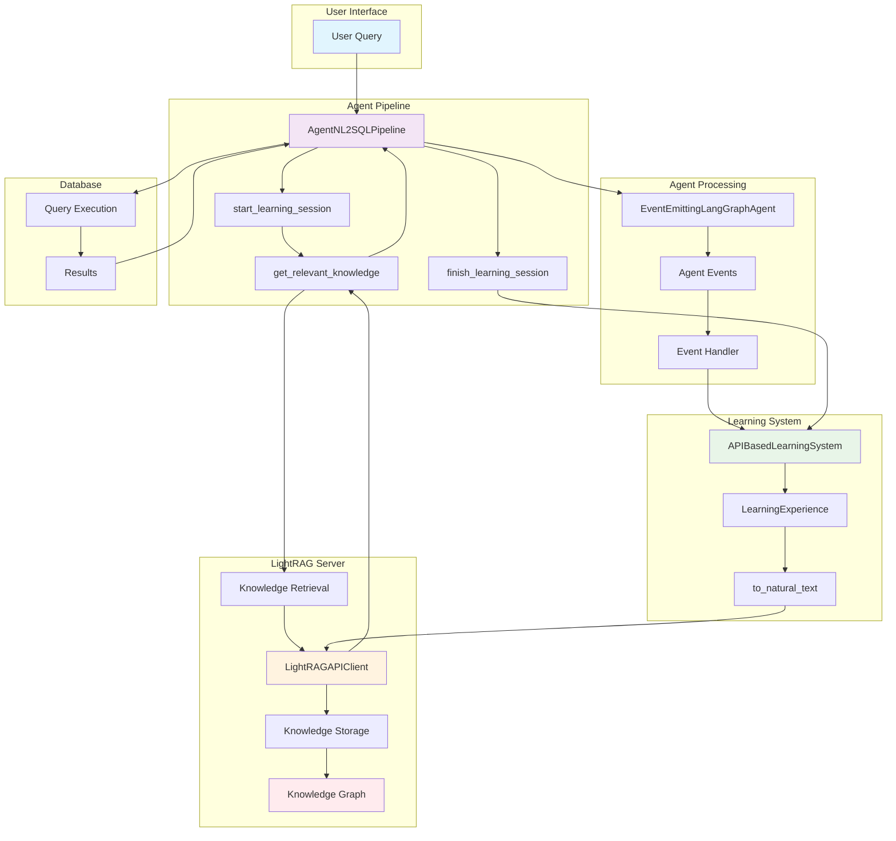
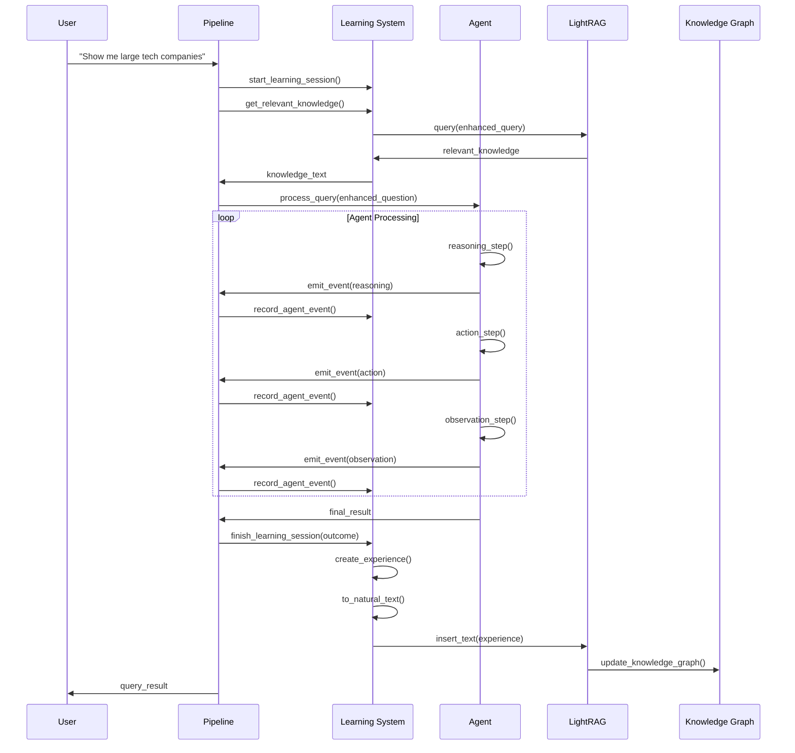
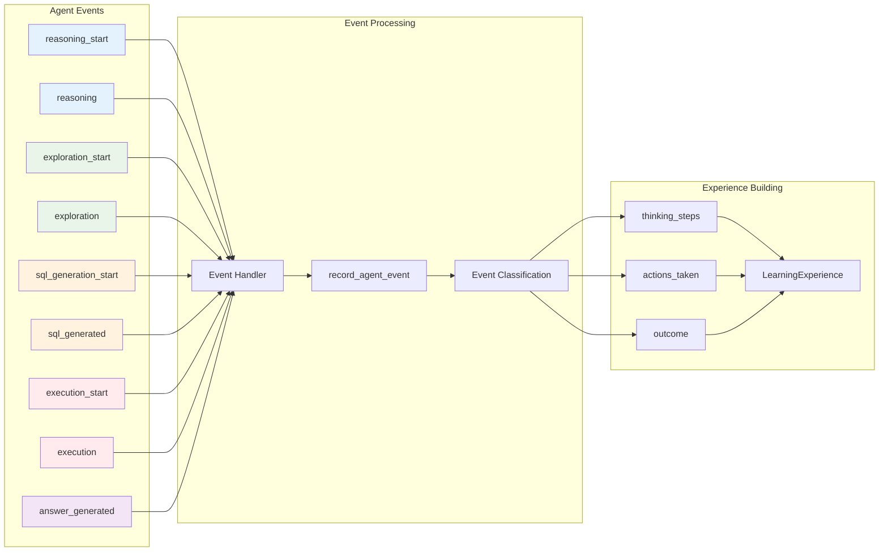
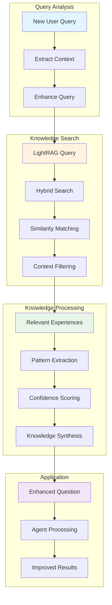
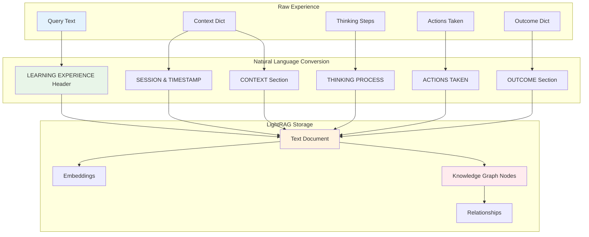
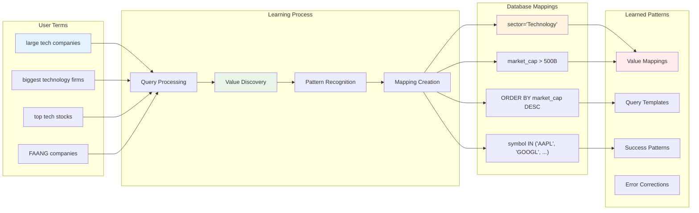
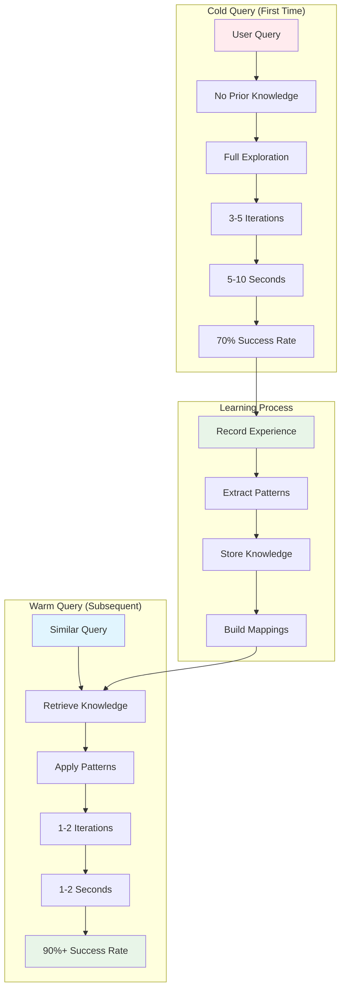

# SENS Learning System Architecture

## System Components and Data Flow

## Learning Workflow Sequence

## Event Recording Process

## Knowledge Retrieval Process

## Experience Storage Format

## Learning Patterns Discovery

## Performance Improvement Cycle

## Architecture Benefits

### 1. **Continuous Learning**
- Every query becomes a learning opportunity
- Patterns are extracted and stored automatically
- Knowledge base grows with usage

### 2. **Contextual Understanding**
- Database-specific knowledge is maintained
- User domain terminology is learned
- Business context is preserved

### 3. **Performance Optimization**
- Repeated patterns are cached
- Successful queries are templates for new ones
- Error corrections are remembered

### 4. **Scalable Knowledge**
- Knowledge graph scales with usage
- Cross-session learning benefits all users
- Domain expertise accumulates over time

### 5. **Self-Improvement**
- System gets better with every interaction
- Failure analysis improves future success
- User feedback refines understanding

## Technical Implementation

### Core Classes

1. **APIBasedLearningSystem**
   - Orchestrates the learning workflow
   - Manages session lifecycle
   - Interfaces with LightRAG API

2. **LearningExperience**
   - Encapsulates a complete query experience
   - Converts to natural language for storage
   - Preserves context and outcomes

3. **LightRAGAPIClient**
   - Handles all LightRAG server communication
   - Manages document insertion and retrieval
   - Provides health monitoring

4. **EventEmittingLangGraphAgent**
   - Emits events during agent processing
   - Provides real-time monitoring
   - Enables learning system integration

### Integration Points

- **Pipeline Integration**: Seamless integration with existing AgentNL2SQLPipeline
- **Event Handling**: Automatic event recording without code changes
- **Knowledge Application**: Transparent knowledge retrieval and application
- **Performance Monitoring**: Built-in analytics and metrics

This architecture creates a self-improving system that becomes more intelligent and efficient with every query processed.
