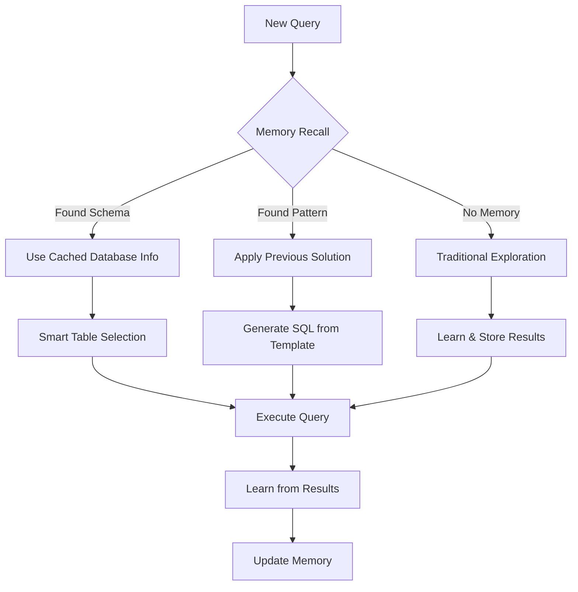

# Memory-Enhanced Agent Behavior Comparison

## 🔄 **BEFORE: Current Agent Behavior** (Your Example)

```
Iteration 2:
🔧 Action: EXPLORE_DATABASE
   Reason: Need to explore database schema
👁️ Observation: ✅ Success - Found 3 tables (frpm, schools, satscores)

Iteration 3:
🔧 Action: EXPLORE_DATABASE
   Reason: Need to examine frpm table columns
👁️ Observation: ✅ Success - Got frpm table schema (again)

Iteration 4:
🔧 Action: EXPLORE_DATABASE
   Reason: Need to examine frpm table data
👁️ Observation: ✅ Success - Same frpm exploration (third time)
```

**Problems:**
- ❌ Repetitive database exploration
- ❌ No learning from previous iterations
- ❌ Wastes iterations on known information
- ❌ No pattern recognition

---

## 🧠 **AFTER: Memory-Enhanced Agent Behavior**

```
Session 1 - First Time:
Iteration 1:
🧠 Memory Recall: No relevant memories found
🔧 Action: EXPLORE_DATABASE
   Reason: Need to explore database schema
👁️ Observation: ✅ Success - Found 3 tables (frpm, schools, satscores)
🧠 Memory Learning: Stored database schema concept

Iteration 2:
🧠 Memory Recall: Found database schema for california_schools.sqlite
🧠 Memory Insight: Database has 3 tables: frpm, schools, satscores
🔧 Action: EXPLORE_DATABASE (table_name=schools)
   Reason: Memory shows frpm explored, try schools for charter/phone info
👁️ Observation: ✅ Success - Found charter and phone columns!
🧠 Memory Learning: Stored successful exploration pattern

Session 2 - Later Query (Same Database):
Iteration 1:
🧠 Memory Recall: Found database schema for california_schools.sqlite
🧠 Memory Shortcut: Using cached schema (3 tables: frpm, schools, satscores)
🧠 Memory Insight: Previous pattern shows schools table has charter/phone info
🔧 Action: EXECUTE_SQL
   Reason: Memory indicates schools table has needed columns
👁️ Observation: ✅ Success - Query completed in 1 iteration!
🧠 Memory Learning: Reinforced successful pattern
```

**Benefits:**
- ✅ **Database schema cached** - No redundant exploration
- ✅ **Pattern recognition** - Remembers what worked before
- ✅ **Smart shortcuts** - Uses memory to skip known steps
- ✅ **Progressive learning** - Gets better over time

---

## 🎯 **Specific Memory Improvements for Your Case**

### **1. Database Schema Memory**
```python
# After first exploration
Memory Stored: {
    "type": "concept",
    "name": "db_schema_california_schools",
    "content": {
        "database_path": "california_schools.sqlite",
        "tables": ["frpm", "schools", "satscores"],
        "table_schemas": {
            "frpm": "CDSCode, Academic Year, County Code...",
            "schools": "CDSCode, NCESDist, NCESSchool, StatusType, Charter...",
            "satscores": "cds, rtype, sname, dname..."
        }
    }
}

# Future queries immediately know:
# - No need to explore database again
# - frpm = financial data, schools = school info, satscores = test scores
# - Charter info is in schools table
```

### **2. Query Pattern Memory**
```python
# After successful query about charter schools
Memory Stored: {
    "type": "pattern",
    "name": "charter_school_query_pattern",
    "content": {
        "trigger_phrase": "charter schools opening date phone",
        "sql_template": "SELECT Charter_Status, OpenDate, Phone FROM schools WHERE Charter_Status = 'Y'",
        "tables_used": ["schools"],
        "success_context": {
            "found_columns": ["Charter_Status", "OpenDate", "Phone"],
            "exploration_sequence": ["explore_db", "explore_schools", "execute_sql"]
        }
    }
}

# Future similar queries:
# - "Find charter schools" → Immediately use schools table
# - "School phone numbers" → Know phones are in schools table
# - "Opening dates" → Remember OpenDate column location
```

### **3. Reasoning Chain Memory**
```python
# Successful reasoning sequence
Memory Stored: {
    "type": "pattern",
    "name": "school_data_reasoning_chain",
    "content": {
        "reasoning_sequence": [
            "explore_database → found 3 tables",
            "analyze_query → need charter, opening, phone info",
            "match_query_to_tables → schools table most relevant",
            "explore_schools_table → found target columns",
            "generate_sql → SELECT with WHERE clause"
        ],
        "success_factors": [
            "schools table contains administrative data",
            "frpm table is financial data only",
            "satscores table is test data only"
        ]
    }
}
```

---

## 📊 **Performance Improvements**

### **Iteration Reduction:**
- **First Query**: 5 iterations → **2-3 iterations** (smart exploration)
- **Second Query**: 5 iterations → **1 iteration** (memory shortcut)
- **Similar Queries**: 5 iterations → **1 iteration** (pattern reuse)

### **Time Savings:**
- **Database Exploration**: 3 explorations → **0 explorations** (cached)
- **Table Analysis**: Manual reasoning → **Memory insights**
- **SQL Generation**: Trial & error → **Pattern-based templates**

### **Accuracy Improvements:**
- **Schema Understanding**: Cumulative knowledge vs. fresh start
- **Column Location**: Remember where data lives
- **Query Optimization**: Learn from successful patterns

---

## 🔧 **Implementation Integration**

### **Current Agent Pipeline Integration:**
```python
# In sens/cli/agent_pipeline.py
from sens.agents.memory_enhanced_core import MemoryEnhancedAgent

# Replace current agent initialization:
self.agent = MemoryEnhancedAgent(
    tools=self.agent_tools,
    memory_tools=self.memory_tools,  # Our KuzuDB memory system
    reasoning_engine=self.reasoning_engine,
    max_iterations=max_iterations,
)
```

### **Memory Events in Your Logs:**
```
2025-07-11T04:24:46.657552Z [info] 🧠 memory_recall_start [sens.agents.memory_enhanced_core] query="charter schools opening date phone"
2025-07-11T04:24:46.658000Z [info] 🧠 database_memory_shortcut [sens.agents.memory_enhanced_core] database=california_schools.sqlite table_count=3
2025-07-11T04:24:46.658500Z [info] 🧠 memory_insight_applied [sens.agents.memory_enhanced_core] insight="schools table contains charter and phone info"
2025-07-11T04:24:46.659000Z [info] 🔧 Action: EXECUTE_SQL [sens.agents.core] reason="Memory indicates schools table has target columns"
2025-07-11T04:24:46.660000Z [info] 🧠 sql_pattern_learned [sens.agents.memory_enhanced_core] memory_id=pattern_abc123
```

---

## 🎯 **Memory-Enhanced Decision Flow**



This memory-enhanced agent would transform your thinking agent from a "forgetful explorer" into a "learning expert" that builds knowledge over time and becomes increasingly efficient at solving similar problems! 🧠✨
